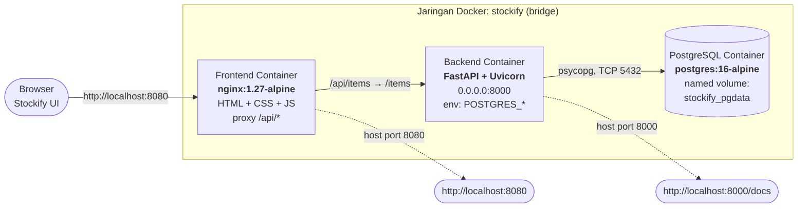
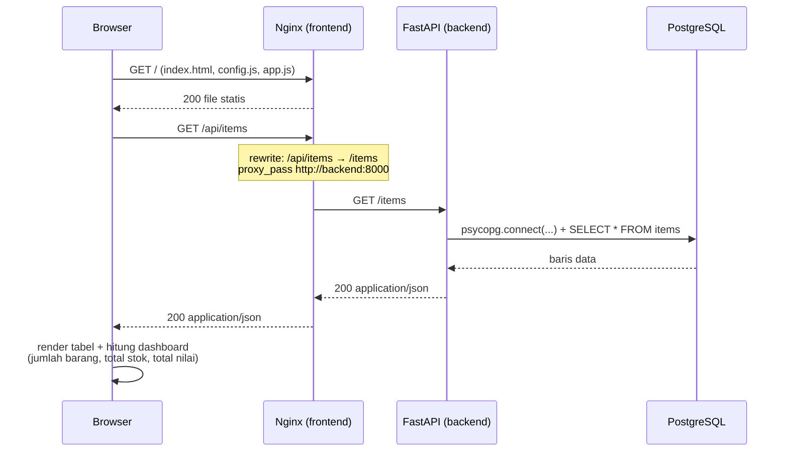
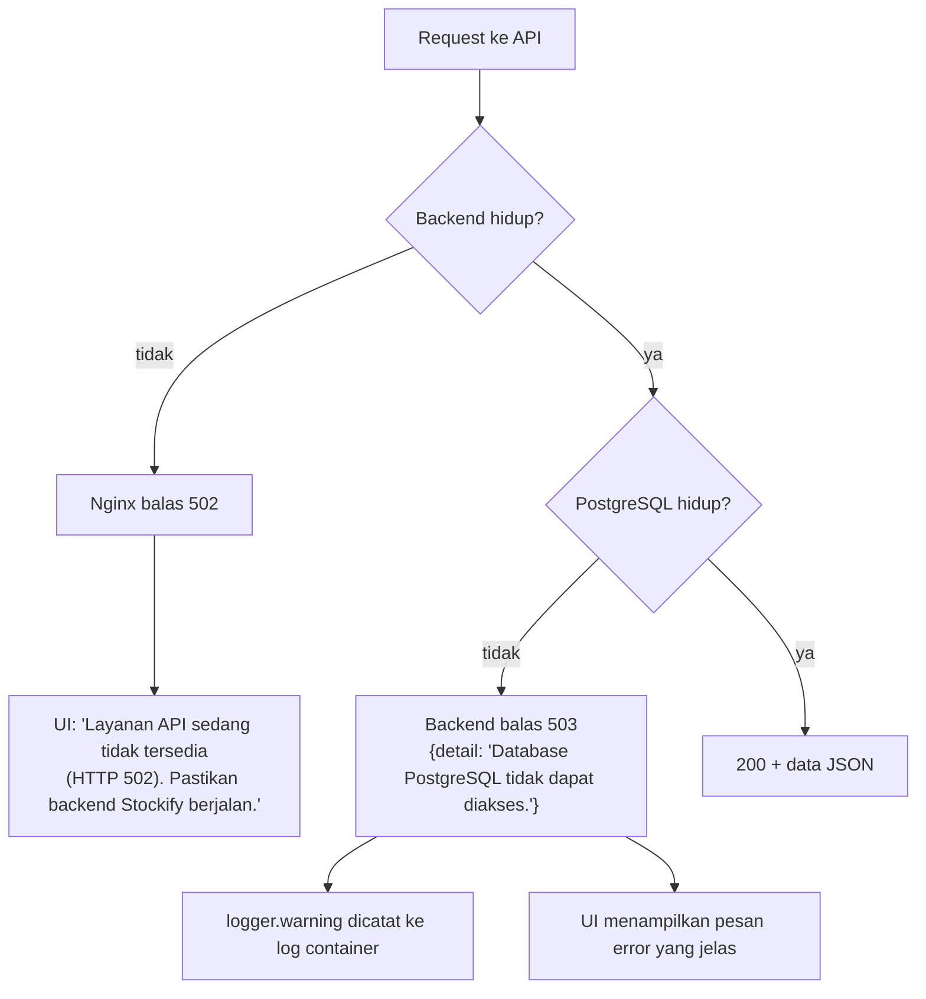

# Arsitektur Stockify

Dokumen ini menjelaskan arsitektur **sesuai implementasi aktual** di repository ini
(`docker-compose.yml`, `backend/main.py`, `docker/nginx/default.conf`).

---

## 1. Diagram Arsitektur

### 1.1 Diagram Mermaid



### 1.2 Diagram ASCII (untuk slide/dokumen cetak)

```
                    ┌────────────────────────────────────────────┐
                    │                Browser                     │
                    │        (Stockify UI - HTML/CSS/JS)          │
                    └───────────────────┬────────────────────────┘
                                        │  http://localhost:8080
                                        │  (HTML, CSS, JS, /api/*)
                                        ▼
        ┌───────────────────────────────────────────────────────────┐
        │  CONTAINER: stockify-frontend        (nginx:1.27-alpine)   │
        │  ─────────────────────────────────────────────────────────  │
        │  • /                → halaman Stockify (static)            │
        │  • /config.js       → alamat API runtime ("/api")           │
        │  • /script/app.js   → logika CRUD + dashboard              │
        │  • /api/*           → proxy ke http://backend:8000/*        │
        │  • /health          → proxy ke backend /health              │
        └───────────────────────────┬───────────────────────────────┘
                                    │  jaringan internal "stockify"
                                    │  HTTP (satu origin → tanpa CORS)
                                    ▼
        ┌───────────────────────────────────────────────────────────┐
        │  CONTAINER: stockify-backend    (python:3.13-slim)        │
        │  ─────────────────────────────────────────────────────────  │
        │  • FastAPI + Uvicorn  → 0.0.0.0:8000                      │
        │  • GET    /                 info service                    │
        │  • GET    /health           health check + cek PostgreSQL   │
        │  • GET    /items            daftar barang                  │
        │  • GET    /items/{id}       satu barang                    │
        │  • POST   /items            create  → 201                  │
        │  • PUT    /items/{id}       update  → 200                  │
        │  • DELETE /items/{id}       delete  → 200                  │
        │  • Validasi Pydantic + CHECK constraint PostgreSQL         │
        │  • Error psycopg → 503 + dicatat ke log container          │
        └───────────────────────────┬───────────────────────────────┘
                                    │  psycopg (libpq), TCP 5432
                                    ▼
        ┌───────────────────────────────────────────────────────────┐
        │  CONTAINER: stockify-db          (postgres:16-alpine)     │
        │  ─────────────────────────────────────────────────────────  │
        │  • Tabel items: id SERIAL PK, name, category, stock, price│
        │  • CHECK (stock >= 0), CHECK (price >= 0)                 │
        │  • Named volume: stockify_pgdata → /var/lib/postgresql/data│
        └───────────────────────────────────────────────────────────┘
```

## 2. Alur Request (Read)



**Catatan Nginx.** `location /api/` memakai `resolver 127.0.0.11` + variabel
`$backend_upstream` agar nama service `backend` di-resolve **saat request** (bukan
saat start). Konsekuensinya: container backend boleh dibuat ulang dengan IP baru
tanpa membuat Nginx salah arah.

> ⚠️ Urutan directive di `location /api/` penting: `set $backend_upstream` harus
> **sebelum** `rewrite ... break`, karena `rewrite ... break` menghentikan fase
> rewrite sehingga directive setelahnya tidak dijalankan.

## 3. Alur Penanganan Error



| Lapis | Penanganan | Bukti di log |
|---|---|---|
| Nginx → backend mati | `502 Bad Gateway` | access log Nginx: `"POST /api/items HTTP/1.1" 502` |
| Backend → PostgreSQL mati | `503` + `{"detail":"Database PostgreSQL tidak dapat diakses."}` | `WARNING: Database PostgreSQL tidak dapat diakses (GET /items): OperationalError: ...` |
| Input tidak valid | `422` + daftar error per field | access log uvicorn: `"POST /items HTTP/1.1" 422` |
| ID tidak ada | `404` + `{"detail":"Barang tidak ditemukan."}` | access log uvicorn |

Batas waktu koneksi database diatur `POSTGRES_CONNECT_TIMEOUT` (default 5 detik)
agar request tidak menggantung tak terbatas — penting agar health check container
dapat assessing dengan cepat.

## 4. Konfigurasi Container

### 4.1 `db` — PostgreSQL

| Aspek | Nilai |
|---|---|
| Image | `postgres:16-alpine` |
| Container name | `stockify-db` |
| Environment | `POSTGRES_USER`, `POSTGRES_PASSWORD`, `POSTGRES_DB` (dari `.env`) |
| Volume | named volume `stockify_pgdata` → `/var/lib/postgresql/data` |
| Port publish | `${DB_HOST_PORT:-5433}:5432` |
| Health check | `pg_isready -U $POSTGRES_USER -d $POSTGRES_DB` (interval 10s, timeout 5s, retries 10, start_period 15s) |
| Restart | `unless-stopped` |

### 4.2 `backend` — FastAPI

| Aspek | Nilai |
|---|---|
| Image | dibangun dari `backend/Dockerfile` (`python:3.13-slim`) |
| Container name | `stockify-backend` |
| Environment | `POSTGRES_HOST=db`, `POSTGRES_PORT=5432`, `POSTGRES_DB`, `POSTGRES_USER`, `POSTGRES_PASSWORD`, `POSTGRES_CONNECT_TIMEOUT=5` |
| Depends on | `db` dengan `condition: service_healthy` |
| Port publish | `${BACKEND_PORT:-8000}:8000` |
| Health check | `python -c "urllib.request.urlopen('http://127.0.0.1:8000/health')"` (interval 15s, timeout 5s, retries 5, start_period 20s) |
| Perintah | `uvicorn main:app --host 0.0.0.0 --port 8000` |

### 4.3 `frontend` — Nginx

| Aspek | Nilai |
|---|---|
| Image | dibangun dari `frontend/Dockerfile` (`nginx:1.27-alpine`) |
| Container name | `stockify-frontend` |
| Depends on | `backend` dengan `condition: service_healthy` |
| Port publish | `${FRONTEND_PORT:-8080}:80` |
| Health check | `wget -q -O /dev/null http://127.0.0.1/` (interval 15s, timeout 5s, retries 5, start_period 10s) |
| Konfigurasi | `docker/nginx/default.conf` |

### 4.4 Volume & network

| Nama | Jenis | Kegunaan |
|---|---|---|
| `stockify_pgdata` | named volume | seluruh data PostgreSQL; bertahan terhadap `docker compose down` |
| `stockify` | bridge network | komunikasi antar container (`backend` → `db`, `frontend` → `backend`) |

## 5. Konfigurasi API Frontend

Frontend tidak meng-hardcode alamat API. Nilai diambil dari `window.STOCKIFY_CONFIG`
yang didefinisikan di `config.js`:

| Environment | File yang dipakai | `apiBase` |
|---|---|---|
| Docker Compose | `docker/frontend-config.js` (di-copy ke `/usr/share/nginx/html/config.js`) | `/api` |
| Development lokal (Live Server) | `frontend/config.js` | `http://127.0.0.1:8000` |

```js
// app.js
const API_BASE =
  (window.STOCKIFY_CONFIG && window.STOCKIFY_CONFIG.apiBase) ||
  "http://127.0.0.1:8000";
```

Karena addressanya **relatif** (`/api`) di mode Docker, request browser berjalan pada
origin yang sama dengan halaman → **tidak ada preflight CORS**. Mode development
lokal memakai URL absolut, dan CORS diizinkan untuk `localhost`/`127.0.0.1`
(apa pun portnya) melalui `allow_origin_regex` di `backend/main.py`.

## 6. Model Data

```sql
CREATE TABLE IF NOT EXISTS items (
    id       SERIAL PRIMARY KEY,
    name     TEXT NOT NULL,
    category TEXT NOT NULL,
    stock    INTEGER NOT NULL CHECK (stock >= 0),
    price    DOUBLE PRECISION NOT NULL CHECK (price >= 0)
);
```

Tabel dibuat otomatis oleh `initialize_database()` saat aplikasi start
(`CREATE TABLE IF NOT EXISTS`, aman dijalankan berulang kali). Perilaku lain:

- `id` bertambah otomatis oleh sequence `SERIAL`.
- Jumlah koneksi: **satu koneksi per request** (dibuka & ditutup di dalam `with`).
- `backend/scripts/migrate_sqlite_to_postgres.py` memindahkan data dari SQLite lama;
  file SQLite dibuka **read-only** (`mode=ro`) dan tidak pernah dihapus.

## 7. Referensi File

| File | Peran |
|---|---|
| `docker-compose.yml` | Definisi 3 service, volume, network, health check |
| `backend/main.py` | Aplikasi FastAPI, konfigurasi DB dari env vars, error handling |
| `backend/Dockerfile` | Build image backend |
| `frontend/Dockerfile` | Build image frontend (Nginx) |
| `docker/nginx/default.conf` | Server Nginx + proxy `/api/*` |
| `docker/frontend-config.js` | `apiBase` versi container |
| `frontend/config.js` | `apiBase` versi development lokal |
| `backend/scripts/migrate_sqlite_to_postgres.py` | Migrasi data SQLite → PostgreSQL |
| `.env.example` | Template seluruh environment variable |
